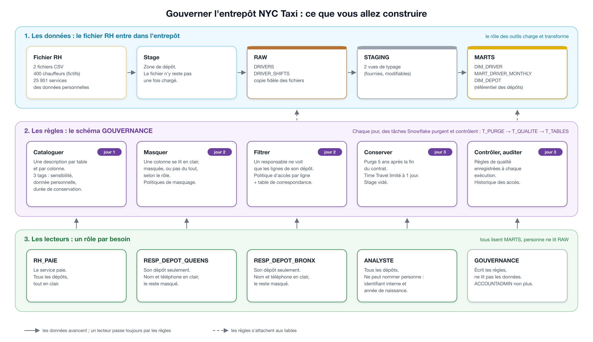

# Brief projet Data Engineer

## 🏷️ Titre

Gouverner l'entrepôt NYC Taxi : catalogue, accès et conservation dans Snowflake

## 📝 Description rapide

Hudson Cab Partners ouvre un entrepôt Snowflake pour les données de ses chauffeurs : noms, téléphones, numéros de licence. Avant de l'ouvrir aux responsables de dépôt, au service paie et à l'analyste, il faut savoir ce qu'il contient, ce que dit la loi, qui a le droit de voir quoi, combien de temps on le garde et si l'on peut s'y fier. Vous menez une veille réglementaire sur le RGPD, vous chargez ce fichier, vous cataloguez les données, vous posez les politiques de masquage et d'accès par ligne, vous automatisez la purge et les règles de qualité avec les tâches planifiées de Snowflake, puis vous prouvez par l'historique des accès que les règles tiennent. Brief guidé en binôme sur 3 jours, à partir d'un compte Snowflake vide.

## 🎯 Compétences et niveaux

| Compétence | Niveau |
|---|---|
| C4. Réaliser une veille technique et réglementaire | 2 (adapter) |
| C19. Intégrer les composants d'infrastructure | 2 (adapter) |
| C20. Gérer le catalogue des données | 1 (imiter) |
| C21. Implémenter les règles de gouvernance des données | 2 (adapter) |

## 📖 Contexte

### La situation

Hudson Cab Partners exploite une flotte de taxis jaunes à New York, depuis trois dépôts : Bronx, Brooklyn et Queens. Vous venez de rejoindre l'équipe data, qui ouvre un entrepôt Snowflake pour un nouveau domaine : le personnel. La direction veut savoir quels dépôts et quels chauffeurs font tourner la flotte. Le service RH vous a donc transmis son fichier du personnel et le relevé des services de janvier à mars 2025.

Priya a aussitôt écrit le SQL qui construit une dimension chauffeur et une table d'activité mensuelle. Elle l'a fait vite, sans se demander ce que contenait le fichier. Or il contient des noms, des adresses e-mail, des téléphones, des dates de naissance et des numéros de licence. Trois services réclament déjà un accès : la paie, les responsables de dépôt, et Priya elle-même.

Personne ne sait dire aujourd'hui quelles colonnes de l'entrepôt décrivent une personne, qui les lit, ni ce que deviennent les données d'un chauffeur parti depuis dix ans. La direction a fixé les règles avec son conseil juridique. Elle vous demande de les mettre en œuvre avant d'ouvrir le moindre accès.

Un détail change tout : depuis cette année, le groupe a confié la gestion de ses données du personnel à Hudson Cab Europe, sa filiale installée à Paris. C'est elle qui porte l'entrepôt et l'équipe data, et elle qui décide désormais de ce que deviennent ces données. Le conseil juridique a rédigé le contrat de gouvernance avant ce transfert. Avant d'écrire la moindre politique, la direction veut savoir quelles règles s'imposent désormais à ces données et si le contrat les respecte.

### La question à laquelle répondre

> Qui peut voir quelle donnée, pendant combien de temps, et peut-on s'y fier ?

Chaque choix des trois jours doit pouvoir se justifier par cette question.

### Ce que vous allez construire

- **La veille réglementaire** : un dispositif de veille, des fiches sur les textes qui s'appliquent, et la confrontation du contrat à ces textes.
- **L'intégration du fichier RH** : stage, tables RAW, chargement rejouable, puis les transformations fournies.
- **Le catalogue** : une description pour chaque table et pour les colonnes des tables principales, trois tags, une vue qui rassemble le tout.
- **Les accès** : quatre rôles métier, des politiques de masquage, une politique d'accès par ligne pilotée par une table de correspondance.
- **La conservation et la qualité** : des tâches Snowflake quotidiennes qui purgent, contrôlent, puis reconstruisent.
- **La preuve** : un cahier de tests des accès et une requête d'audit.

### Les sources de données

| Source | Format | Volume | Où |
|---|---|---|---|
| Chauffeurs | 1 fichier CSV | 400 lignes, 10 colonnes | `data/drivers.csv` du kit |
| Services | 1 fichier CSV | 25 951 lignes, 8 colonnes | `data/driver_shifts.csv` du kit |

Le fichier RH est fictif : on ne s'exerce pas à la gouvernance sur de vraies personnes. Aucun chauffeur n'existe et les adresses e-mail ne mènent nulle part. Il se traite pourtant comme un vrai fichier du personnel, et comme tout fichier venu d'un autre service, il contient des erreurs.

### Ce qui vous est fourni

Un kit de démarrage : le script d'installation de Snowflake et ceux du chargement, le guide étape par étape (`GUIDE_BRIEF_GOUVERNANCE.md`), le contrat de gouvernance (`CONTRAT_GOUVERNANCE.md`), les deux fichiers RH, les fichiers SQL de Priya, trois modèles de documents et des exemples commentés. L'étape 0 du guide explique chaque dossier et comment installer le kit.

### Contraintes techniques

- Snowflake en édition Enterprise (voir l'étape 0 du guide).
- Les règles sont portées par des rôles, jamais par des utilisateurs nommés.
- Le rôle qui écrit les règles ne lit pas les données ; ACCOUNTADMIN non plus.
- Tout est écrit dans des fichiers SQL versionnés et rejouables : rien n'est saisi à la main dans l'interface, sauf le dépôt des deux fichiers sur le stage.
- Les règles survivent à une exécution du pipeline.
- Aucun secret et aucune donnée personnelle dans le dépôt GitHub public.

### Vocabulaire

| Terme | Sens |
|---|---|
| Donnée personnelle | information qui se rapporte à une personne identifiée ou identifiable |
| Catalogue | l'inventaire documenté des données : ce que contient chaque table, d'où elle vient, qui en répond |
| Tag | étiquette posée sur une table ou une colonne ; elle décrit, et peut déclencher une règle |
| Politique de masquage | règle qui transforme la valeur d'une colonne selon le rôle qui la lit |
| Politique d'accès par ligne | règle qui cache certaines lignes selon le rôle qui lit |
| Minimisation | ne conserver et ne montrer que les données nécessaires à un usage |
| Durée de conservation | délai au bout duquel une donnée doit être supprimée |
| Time Travel, Fail-safe | les deux délais pendant lesquels Snowflake garde une donnée supprimée |
| Lignage | le chemin d'une donnée, de sa source aux tables qui en dépendent |
| Registre des traitements | document qui décrit ce qu'une organisation fait des données personnelles |
| Rôle des outils | le rôle Snowflake avec lequel se font le chargement et les tâches planifiées : `TRANSFORMER`, créé à l'installation |
| Dépôt | le garage d'où partent les taxis (Queens, Bronx, Brooklyn) ; à ne pas confondre avec votre dépôt GitHub |

## 🧭 Modalités pédagogiques

### Organisation

- **Durée et format** : 3 jours, en binôme, en autonomie accompagnée.
- **Document de référence** : `CONTRAT_GOUVERNANCE.md`. Il dit ce qui est exigé, pas comment le faire.
- **Répartition** : pendant qu'un membre écrit une politique, l'autre écrit le test qui la vérifie, puis vous échangez.
- **Règle d'or** : un test s'écrit avant la politique qu'il vérifie.

- **Guide** : `GUIDE_BRIEF_GOUVERNANCE.md` donne, pour chaque jour, les étapes, les fichiers à créer, les rôles à utiliser, les pièges et le résultat à obtenir. Commencez par son étape 0.

### Le déroulé

- **Jour 1, matin (sans code)** : savoir quelles règles s'imposent aux données des chauffeurs, et si le contrat les respecte. Il en sort la note de veille et l'inventaire des données personnelles.
- **Jour 1, après-midi** : charger le fichier RH sans le publier, et documenter les tables et leurs colonnes. Aucune politique ce jour-là : on ne protège pas ce que l'on n'a pas inventorié.
- **Jour 2** : décider qui voit quoi, l'écrire en tests, puis en politiques. Il en sort un cahier de tests entièrement vert.
- **Jour 3** : purger, contrôler la qualité chaque jour, prouver qui a lu quoi, présenter.

**Bonus** : classification automatique de Snowflake comparée à votre inventaire ; alerte Snowflake quand une règle de qualité passe en `ALERTE` ; politique d'agrégation pour l'analyste.

## 📊 Modalités d'évaluation

L'évaluation se fait par binôme, en deux volets. Chaque membre doit pouvoir expliquer l'ensemble.

### Présentation du projet (70 %)

15 minutes au plus, en deux parties présentées chacune par un membre différent du binôme, puis 5 minutes de questions aux deux.

**Partie 1 — La veille (environ 5 minutes, premier membre)** :

1. Le droit applicable : le RGPD s'applique-t-il à ces chauffeurs, et par quel article ? Qui est responsable du traitement ?
2. L'écart le plus important entre le contrat et les textes, et ce que vous proposez.
3. Le dispositif de veille : comment l'équipe serait prévenue d'une nouvelle recommandation.

**Partie 2 — La gouvernance des données (environ 10 minutes, second membre)** : à quoi elle sert pour Hudson Cab, puis comment elle fonctionne, en direct dans Snowsight.

1. À quoi ça sert : qui doit voir quoi, combien de temps on garde les données, comment on sait qu'on peut s'y fier.
2. Le catalogue : retrouver une colonne personnelle dans la vue du catalogue, avec sa description et ses tags.
3. Le masquage et le filtrage : la même requête sur la dimension chauffeur avec quatre rôles, dont ACCOUNTADMIN, et ce que chacun voit.
4. La table de correspondance : ajouter un dépôt à un responsable, sans toucher à la politique.
5. Les tâches planifiées : une exécution de la chaîne, les résultats de qualité, et la preuve que politiques et tags sont toujours en place.
6. La conservation et l'audit : les chauffeurs avant et après la purge, ce qu'il reste dans Time Travel, et qui a lu les données.

### Revue de dépôt et de conception (30 %)

Lecture du dépôt GitHub : la vue du catalogue, scripts rejouables, absence de secret et de donnée personnelle, note de veille, registre et inventaire, accès et cahier de tests, README. Les questions portent sur les choix : quel article rend le RGPD applicable, comment vous seriez prévenus d'une nouvelle recommandation de la CNIL, pourquoi masquer cette colonne plutôt que la supprimer, pourquoi une table de correspondance, que voit le rôle des outils et pourquoi, que se passe-t-il si le service RH renvoie un fichier complet le mois prochain, dans combien de jours une donnée purgée a-t-elle réellement disparu.

### Validation partielle

Chaque compétence est validée séparément. Un binôme dont les tâches ne tournent pas, mais dont les politiques sont justes et prouvées par le cahier de tests, peut valider C21 ; C19 ne serait pas validée. À l'inverse, des politiques qui disparaissent à la première exécution du pipeline, ou un fichier RH présent dans le dépôt public, ne valident pas C21, même si la présentation réussit. C4 se valide sur la note de veille et sa présentation, indépendamment du code.

## 📦 Livrables attendus

**1. Le dépôt GitHub public** `hudson-cab-gouvernance` :

| Dossier ou fichier | Contenu |
|---|---|
| `README.md` | section « Gouvernance » : ce qui est protégé et comment, ordre d'exécution des scripts, choix techniques, limites connues |
| `snowflake/gouvernance/` | scripts SQL rejouables : schéma, rôles et droits, tags, politiques, table de correspondance, requête d'audit |
| `snowflake/rh/` | les fichiers SQL du domaine RH, modifiés si besoin, la purge, la conservation, les fiches de catalogue, la vue du catalogue, vos règles de qualité et vos tâches planifiées |
| `docs/` | `VEILLE.md` (note de veille) ; `REGISTRE.md` (inventaire et registre du traitement) ; `ACCES.md` (carte des droits et cahier de tests, attendu et obtenu) ; les captures |
| `.gitignore` | exclut le fichier RH |

**2. Les captures d'écran**, dans `docs/` (le guide dit à quel moment les faire) : l'abonnement à votre outil de veille, l'onglet Lineage de `MART_DRIVER_MONTHLY`, les tags d'une table dans Snowsight, la même requête lue par deux rôles, le graphe des tâches avec une exécution réussie, le contenu de `QUALITE_RESULTATS`, le résultat de la requête d'audit.

## ✅ Critères de performance

### C4 — Réaliser une veille technique et réglementaire

- Le droit applicable est établi et justifié par l'article précis du texte.
- Le dispositif de veille nomme au moins trois sources officielles, une fréquence et un outil de suivi en place.
- Au moins quatre fiches citent leur source et sa date, et disent ce que le texte change pour l'entrepôt.
- Chaque règle du contrat est confrontée aux textes ; les écarts relevés figurent dans le README.

### C19 — Intégrer les composants d'infrastructure

- Les deux fichiers RH sont chargés avec les scripts fournis, dont le binôme explique chaque étape (format de fichier, stage, COPY INTO) ; le stage est vide après le chargement.
- Les tâches planifiées enchaînent purge, règles de qualité, puis reconstruction des tables, et s'exécutent avec succès avec le rôle des outils.
- Politiques, tags et descriptions sont toujours en place après une exécution des tâches.
- Le README permet de rejouer toute l'installation dans l'ordre ; aucun secret ni donnée personnelle dans le dépôt.

### C20 — Gérer le catalogue des données

- Chaque table du domaine RH a une description qui dit sa signification, sa source et son rythme de mise à jour ; chaque colonne de `DIM_DRIVER` et de `RAW.DRIVERS` est décrite.
- Toutes les colonnes personnelles de l'inventaire portent le tag `DONNEE_PERSONNELLE`, y compris les colonnes calculées ; chaque table porte sa sensibilité et sa durée de conservation.
- La vue `V_CATALOGUE` rassemble descriptions et tags, et un rôle métier peut l'interroger.
- Les règles de qualité sont documentées (énoncé, seuil, gravité) et le lignage d'une table est présenté.

### C21 — Implémenter les règles de gouvernance

- Chaque rôle voit exactement les lignes et les valeurs de la matrice, ACCOUNTADMIN et le rôle de gouvernance compris : le cahier de tests le prouve.
- L'accès par dépôt repose sur la table de correspondance : ajouter un dépôt ne demande aucune modification de politique.
- La purge supprime les chauffeurs partis depuis plus de 5 ans dans toutes les tables ; Time Travel est limité à 1 jour sur les tables concernées.
- Au moins trois règles de qualité, dont `service_rattache`, s'exécutent et s'enregistrent ; la règle bloquante arrête la chaîne de tâches en cas de dépassement.
- Une requête sur l'historique des accès établit qui a lu les données personnelles, et la fiche de registre est renseignée avec ses preuves.

## 🔗 Ressources

Voir `RESSOURCES.md` : guides, documentation et vidéos, jour par jour.
