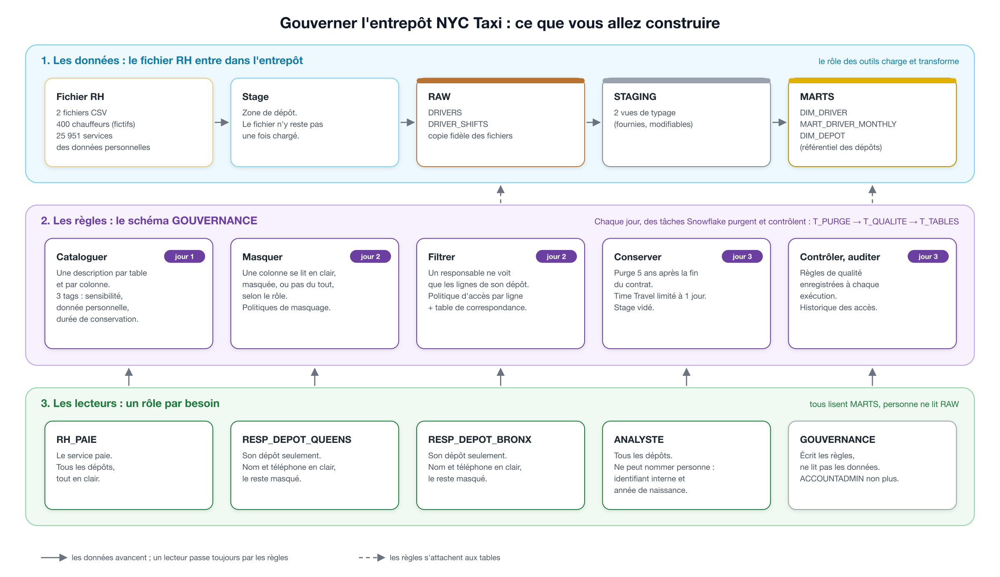

# Brief Data Engineer — Gouverner l'entrepôt NYC Taxi : catalogue, accès et conservation dans Snowflake

> Apprenants : commencez par [`BRIEF.md`](BRIEF.md). Cette page s'adresse au formateur.

Brief guidé de 3 jours, en binôme, à partir d'un compte Snowflake vide. Les apprenants chargent dans un nouvel entrepôt un fichier RH fictif de chauffeurs, le cataloguent (descriptions, tags, vue du catalogue), posent les politiques de masquage et d'accès par ligne, automatisent par des tâches Snowflake la purge et les règles de qualité, puis prouvent par l'historique des accès que les règles tiennent.

## Contenu du dossier

| Fichier | Pour qui | Rôle |
|---|---|---|
| `BRIEF.md` | apprenants | le brief complet, à lire sur GitHub |
| `RESSOURCES.md` | apprenants | guides, documentation et vidéos, jour par jour |
| `starter-kit/` | apprenants | guide des étapes (dont l'étape 0 : installer le kit), contrat, fichiers RH fictifs, fichiers SQL fournis, trois modèles de documents, fiche juridique et exemples commentés |

Ce dossier ne contient ni la solution ni la grille de notation : elles sont conservées hors de ce dépôt public.

## Compétences visées

C4, C19 et C21 au niveau 2 (adapter) ; C20 au niveau 1 (imiter).

## Prérequis des apprenants

Aucun brief précédent requis : le kit part d'un compte Snowflake vide (installation). Avoir déjà écrit du SQL ; tout se fait dans Snowsight, sans Python ni outil à installer. Compte Snowflake en édition Enterprise (le compte d'essai le permet).

## Les données

Le fichier RH est fictif, généré par un script à graine fixe conservé hors de ce dépôt : aucune personne réelle, adresses en `.example`. Il contient des anomalies volontaires que les règles de qualité mesurent.

## Publier le brief sur Simplonline

1. Copier chaque section de `BRIEF.md` dans le champ du même nom, puis `RESSOURCES.md` dans le champ Ressources. Les limites de caractères de chaque champ sont respectées.
2. L'éditeur de Simplonline n'affiche pas les tableaux : une version déjà convertie, un fichier par champ, est générée en local dans un dossier `simplonline/`, qui n'est pas versionné.
3. Insérer l'image `starter-kit/docs/gouvernance.png` dans le contexte avec le bouton image de l'éditeur.

## Guides du cours utilisés par le brief

- Jours 1 et 2 : [Authentification et gouvernance des données](../../../../04-Cloud-Platforms/snowflake/15-gouvernance.md)
- Jour 3 : [Stockage et protection des données](../../../../04-Cloud-Platforms/snowflake/13-stockage-protection.md), puis [Transformer dans Snowflake, section 7 : tâches planifiées](../../../../04-Cloud-Platforms/snowflake/18-transformation.md)
