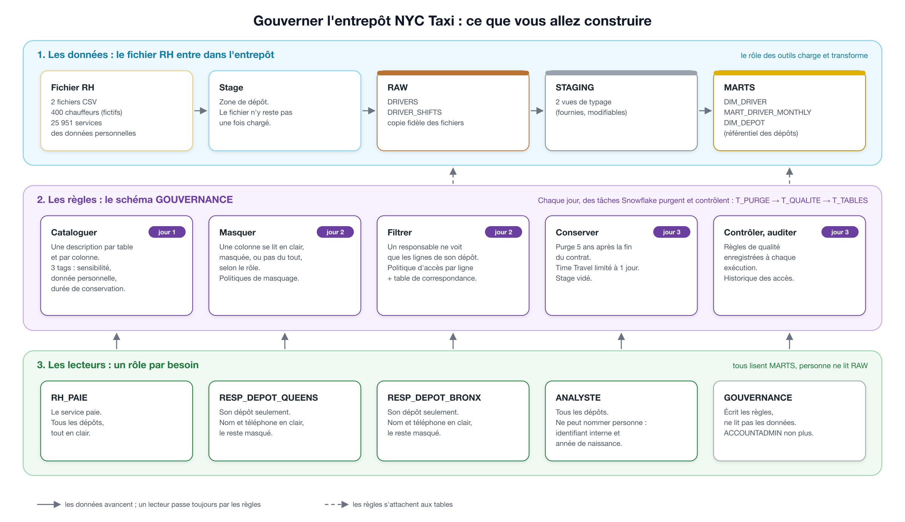

# Le guide du brief, étape par étape



Ce fichier est le seul à suivre au quotidien. Il commence par l'étape 0, qui explique le kit. Chaque journée suit ensuite le même plan : le guide de cours à lire d'abord, les étapes numérotées, les pièges, le résultat à obtenir avant de passer à la suite.

Deux documents l'accompagnent : `CONTRAT_GOUVERNANCE.md`, ce qui est imposé (à garder ouvert les trois jours), et `RESSOURCES.md`, dans le dossier du brief sur GitHub.

---

## Étape 0 — Installer le kit et préparer Snowflake (30 min, avant le jour 1)

### À quoi sert le kit

Ce brief part d'un compte Snowflake vide, et tout se fait dans Snowsight, l'interface web de Snowflake : pas de Python, pas d'outil à installer sur votre poste en dehors de Git. Le kit vous apporte tout ce que vous n'avez pas à inventer : le script d'installation, les deux fichiers RH et les scripts qui les chargent, les fichiers SQL qui les transforment, le contrat, les modèles de documents et des exemples. Ce que vous construisez (les règles, le catalogue, les tâches planifiées) reste à écrire.

### 1. Le dépôt et le kit

1. Créez sur GitHub un dépôt **public** nommé `hudson-cab-gouvernance`, **vide** (sans README ni `.gitignore` : le kit apporte le sien), puis clonez-le sur votre poste : `git clone <adresse du dépôt>`.
2. Copiez le kit dedans. À lancer depuis le dossier qui contient `hudson-cab-gouvernance` (sans télécharger tout le dépôt de cours) :

   ```bash
   git clone --depth 1 --filter=blob:none --sparse https://github.com/gsoulat/formation-data-IA.git
   cd formation-data-IA
   git sparse-checkout set "99-Brief/Data-Engineer/Snowflake/Snowflake+Gouvernance/starter-kit"
   cd ..
   cp -R "formation-data-IA/99-Brief/Data-Engineer/Snowflake/Snowflake+Gouvernance/starter-kit/." hudson-cab-gouvernance/
   rm -rf formation-data-IA
   cd hudson-cab-gouvernance
   ```
3. Vérifiez : à la racine du dépôt, vous voyez `CONTRAT_GOUVERNANCE.md`, `GUIDE_BRIEF_GOUVERNANCE.md`, `.gitignore` (fichier caché : `ls -a`), et les dossiers `data/`, `docs/`, `exemples/` et `snowflake/`. Le `.gitignore` exclut déjà les fichiers de secrets ; pour le fichier RH, c'est à vous de décider (jour 1, étape 7). **Ne faites ni `git commit` ni `git push` avant l'étape 7 du jour 1** : un fichier publié reste dans l'historique de GitHub, même supprimé ensuite.

### 2. Snowflake

1. **Le compte** : un compte d'essai en édition **Enterprise** (lien dans `RESSOURCES.md`). Le masquage, le filtrage des lignes et l'historique des accès n'existent pas en édition Standard. Choisissez une région ; vous en reparlerez dans la veille du jour 1.
2. **L'installation** : dans Snowsight, avec `ACCOUNTADMIN`, exécutez `snowflake/00_installation.sql` en entier. Il crée le warehouse `NYC_TAXI_WH`, la base `NYC_TAXI` et ses schémas `RAW`, `STAGING`, `MARTS`, et le **rôle des outils** `TRANSFORMER`, avec lequel vous chargerez les données et ferez tourner les tâches planifiées. C'est fini quand la dernière requête affiche les trois schémas.

### Ce que contient chaque dossier, et ce que vous en faites

| Où | Contenu | Ce que vous en faites |
|---|---|---|
| `CONTRAT_GOUVERNANCE.md` | les noms imposés, la matrice des accès, les durées de conservation, les règles de qualité | **lire** ; c'est la référence, vous ne le modifiez pas |
| `GUIDE_BRIEF_GOUVERNANCE.md` | ce guide | **suivre**, chaque matin |
| `data/` | `drivers.csv` (400 chauffeurs) et `driver_shifts.csv` (25 951 services), personnes fictives | **charger** dans `RAW` ; **ne pas publier** sur GitHub (jour 1, étape 7) |
| `snowflake/` | `00_installation.sql` (étape 0) ; dans `rh/`, le chargement des fichiers RH (`chargement_rh_1_preparer.sql`, `chargement_rh_2_copier.sql`) et les fichiers SQL de Priya, qui créent et remplissent `DIM_DEPOT`, `DIM_DRIVER` et `MART_DRIVER_MONTHLY`, et une règle de qualité modèle (`controles/`) ; dans `gouvernance/`, un modèle de fiche de catalogue | **exécuter** ; les SQL de Priya se **modifient** si besoin ; vous ajoutez vos fiches de catalogue, vos règles de qualité et vos tâches dans `rh/`, vos scripts de gouvernance (rôles, droits, politiques, conservation, audit) dans `gouvernance/` |
| `docs/` | trois modèles : `VEILLE_MODELE.md`, `REGISTRE_MODELE.md`, `ACCES_MODELE.md`, et le schéma | **remplir** : copiez chaque modèle sans `_MODELE` (`VEILLE.md`…) ; ce sont vos livrables |
| `exemples/` | `FICHE_JURIDIQUE.md` et des scripts SQL commentés sur un petit cas indépendant | **lire et exécuter** pour apprendre les gestes, puis **adapter** ; jamais copier tel quel |

Les exemples, dans l'ordre où vous en aurez besoin :

| Fichier | Ce qu'il montre | Jour |
|---|---|---|
| `FICHE_JURIDIQUE.md` | les mots du RGPD, qui décide et qui exécute, comment lire l'article 3 | 1 matin |
| `00_bac_a_sable.sql` | créer des rôles, donner la propriété d'un schéma, accorder la lecture | 1 |
| `01_role_gouvernance.sql` | un rôle qui écrit les règles sans lire les données ; le droit de poser un tag | 1 |
| `02_masquage_par_tag.sql` | masquer toutes les colonnes qui portent un tag, avec une exception ; script rejouable | 2 |
| `03_acces_par_ligne.sql` | filtrer les lignes avec une table de correspondance | 2 |
| `04_vue_catalogue.sql` | une vue de catalogue | 3 |
| `05_taches_planifiees.sql` | enchaîner des tâches chaque jour, enregistrer le résultat d'une règle, puis s'arrêter si elle dépasse | 3 |
| `99_nettoyage.sql` | supprimer le bac à sable | — |

### L'ordre d'exécution des scripts fournis

Les scripts fournis s'exécutent une fois, dans cet ordre, chacun dans une feuille Snowsight, en entier (Cmd+Maj+Entrée). Chacun commence par le bon `USE ROLE` ; vérifiez quand même le rôle affiché en haut à droite après l'exécution.

| Ordre | Quand | Script (dans `snowflake/`) | Rôle | C'est bon quand |
|---|---|---|---|---|
| 1 | étape 0 | `00_installation.sql` | `ACCOUNTADMIN` | 3 schémas : `RAW`, `STAGING`, `MARTS` |
| 2 | jour 1, étape 8 | `rh/chargement_rh_1_preparer.sql` | `TRANSFORMER` | le stage `RH_STAGE` existe |
| 3 | jour 1, étape 8 | dépôt des 2 CSV depuis Snowsight (pas de SQL) | `TRANSFORMER` | `LIST @NYC_TAXI.RAW.RH_STAGE;` : 2 fichiers |
| 4 | jour 1, étape 8 | `rh/chargement_rh_2_copier.sql` | `TRANSFORMER` | 400 et 25 951 lignes, stage vide |
| 5 | jour 1, étape 9 | `rh/00_tables_rh.sql` | `TRANSFORMER` | 3 tables créées dans `MARTS` |
| 6 | jour 1, étape 9 | `rh/staging/stg_rh__drivers.sql`, puis `rh/staging/stg_rh__driver_shifts.sql` | `TRANSFORMER` | 2 vues ; 25 933 services |
| 7 | jour 1, étape 9 | `rh/marts/dim_depot.sql`, `rh/marts/dim_driver.sql`, puis `rh/marts/mart_driver_monthly.sql` | `TRANSFORMER` | 3, 400 et 914 lignes |

Ensuite, ce sont vos propres scripts, dans l'ordre des étapes du guide : `gouvernance/01_gouvernance.sql` (jour 1), `gouvernance/02_roles_metier.sql`, `03_masquage.sql`, `04_acces_depot.sql` (jour 2), puis la purge, la conservation, les tâches et l'audit (jour 3). Le dossier `exemples/` s'exécute à part, dans sa propre base, au moment indiqué.

### Les données et les fichiers SQL fournis

- Les dépôts (les garages d'où partent les taxis, voir le vocabulaire du brief) sont décrits dans `MARTS.DIM_DEPOT`, un petit référentiel sans donnée personnelle créé par les SQL fournis.
- `00_tables_rh.sql` crée les trois tables de `MARTS` une seule fois. Les fichiers de `marts/` les vident et les remplissent (`INSERT OVERWRITE`) sans les recréer : ce qui est posé dessus (tags, politiques) reste en place. Un `CREATE OR REPLACE TABLE`, lui, recrée la table et efface tout.

### Quatre réflexes pour tout le brief

1. **Un rôle à la fois** : avant de tester un rôle, `USE SECONDARY ROLES NONE;`. Sinon Snowflake active tous vos rôles en même temps et leurs droits s'additionnent.
2. **Le warehouse après le rôle** : après chaque `USE ROLE`, `USE WAREHOUSE NYC_TAXI_WH;` (ou le nom du vôtre). Un rôle sans droit sur le warehouse ne peut rien exécuter, et rien ne s'affiche.
3. **Le bon rôle dans chaque feuille** : dans Snowsight (Workspaces), chaque fichier garde son propre rôle, affiché en haut à droite. Vérifiez-le avant d'exécuter, ou commencez chaque script par `USE ROLE …`. Un SQL fourni exécuté avec `ACCOUNTADMIN` au lieu du rôle des outils crée des objets que le rôle des outils ne peut plus modifier (« does not exist or not authorized »), et recopie des valeurs masquées dans les tables. Pour rendre ces objets au rôle des outils, avec `ACCOUNTADMIN` : `GRANT OWNERSHIP ON ALL TABLES IN SCHEMA NYC_TAXI.MARTS TO ROLE TRANSFORMER COPY CURRENT GRANTS;` (de même pour `RAW`, et `ALL VIEWS` pour `STAGING`), puis relancez le script avec le bon rôle.
4. **Vérifier la fin d'un script** : « Run All » (Cmd+Maj+Entrée) s'arrête à la première erreur, sans le montrer clairement. Terminez chaque script par une requête de vérification : si elle n'affiche rien, une requête plus haut a échoué.

### Valeurs de contrôle

| Mesure | Valeur |
|---|---|
| `RAW.DRIVERS` après chargement | 400 |
| `RAW.DRIVER_SHIFTS` après chargement | 25 951 |
| `STAGING.STG_RH__DRIVER_SHIFTS` | 25 933 |
| `MARTS.DIM_DRIVER` avant la purge | 400 |
| `MARTS.MART_DRIVER_MONTHLY` | 914 |

---

## Jour 1 — S'informer, inventorier, charger et cataloguer

### Matin — La veille réglementaire (sans code)

**À lire d'abord** : `exemples/FICHE_JURIDIQUE.md`. **Sources** : `RESSOURCES.md`, rubrique « Jour 1 — matin ». **Documents à remplir** : `docs/VEILLE.md` et la partie 1 de `docs/REGISTRE.md`. Ils n'existent pas encore : créez-les en copiant les trames vides du kit, qui donnent les rubriques sans les réponses :

```bash
cp docs/VEILLE_MODELE.md docs/VEILLE.md
cp docs/REGISTRE_MODELE.md docs/REGISTRE.md
cp docs/ACCES_MODELE.md docs/ACCES.md
```

1. **Lire le contrat** : ouvrez `CONTRAT_GOUVERNANCE.md`, à la racine de votre dépôt, et lisez-le en entier. Ouvrez ensuite `data/drivers.csv` et `data/driver_shifts.csv` dans un tableur ou un éditeur.
2. **Faire l'inventaire des données personnelles** dans la partie 1 de `docs/REGISTRE.md` : pour chaque colonne des deux fichiers, dit-elle quelque chose d'une personne ? Permet-elle de l'identifier seule, ou seulement combinée à d'autres ? Les valeurs possibles du tag sont dans le contrat, section 3.
3. **Établir le droit applicable** (section 1 de `docs/VEILLE.md`) : le RGPD s'applique-t-il à des chauffeurs new-yorkais dont les données sont gérées à Paris ? Trouvez l'article qui le dit, puis qui est responsable du traitement et qui est sous-traitant.
4. **Mettre en place le dispositif de veille** (section 2) : au moins trois sources officielles, une fréquence, un outil qui vous prévient (lecteur de flux RSS, alerte, lettre d'information). Abonnez-vous vraiment, et gardez une capture de l'abonnement dans `docs/`.
5. **Rédiger au moins quatre fiches de veille** (section 3) : un texte ou une recommandation par fiche, ce qu'il dit, ce qu'il change pour l'entrepôt.
6. **Confronter le contrat aux textes**, règle par règle (section 4). Chaque écart se recopie aussi dans votre `README.md`, à la racine du dépôt, dans une section « Gouvernance » : vous signalez, vous ne réécrivez pas le contrat.

### Après-midi — Protéger le dépôt, charger et cataloguer

**À lire d'abord** : [Authentification et gouvernance des données](https://github.com/gsoulat/formation-data-IA/blob/main/04-Cloud-Platforms/snowflake/15-gouvernance.md), section 5.3 (tags) ; puis exécutez `exemples/00_bac_a_sable.sql` et `exemples/01_role_gouvernance.sql`.

7. **Ne pas publier le fichier du personnel.** Votre dépôt `hudson-cab-gouvernance` est public sur GitHub : tout le monde peut le lire. Le kit vient d'y copier les deux fichiers RH dans `data/`. Un fichier du personnel peut-il être publié, même fictif ? Décidez, appliquez votre décision (indice : `.gitignore`), puis vérifiez avec `git status` que ces fichiers n'apparaissent plus parmi ceux à envoyer. Justifiez en une phrase dans votre `README.md`.
8. **Charger les deux fichiers dans `RAW`** avec les deux scripts fournis, dans `snowflake/rh/`, avec le rôle des outils. Trois temps : exécutez `chargement_rh_1_preparer.sql` (format de fichier, stage, tables) ; déposez les deux CSV sur le stage depuis Snowsight (onglet **Databases**, puis `NYC_TAXI`, `RAW`, `Stages`, `RH_STAGE`, bouton **+ Files**) et vérifiez avec `LIST @NYC_TAXI.RAW.RH_STAGE;` qu'ils y sont ; exécutez `chargement_rh_2_copier.sql`, qui copie les fichiers dans les tables puis vide le stage. Relancez ce second script : il ne doit rien charger de plus. Expliquez dans votre `README.md`, en quelques lignes, à quoi servent le format de fichier, le stage, `COPY INTO` et `PURGE = TRUE` (règle R3) ; le guide de chargement (`RESSOURCES.md`) détaille chaque commande. C'est fini quand `RAW.DRIVERS` compte 400 lignes, `RAW.DRIVER_SHIFTS` 25 951, et que le stage est vide.
9. **Exécuter les fichiers SQL fournis**, dans Snowsight, avec le rôle des outils, dans cet ordre : `snowflake/rh/00_tables_rh.sql`, puis les deux vues de `staging/`, puis `marts/dim_depot.sql`, `marts/dim_driver.sql` et `marts/mart_driver_monthly.sql`. C'est fini quand les volumes correspondent aux valeurs de contrôle de l'étape 0.
10. **Créer ce qui porte les règles, et donner les droits.** Écrivez `snowflake/gouvernance/01_gouvernance.sql`, en vous inspirant de `exemples/00` et `exemples/01`. Chaque droit ci-dessous servira plus tard : les donner maintenant évite de chercher, au jour 2 ou 3, pourquoi une commande est refusée.
    - **Avec `ACCOUNTADMIN`** : créer le rôle `GOUVERNANCE` (celui qui écrira les règles sans voir les données) et vous le donner ; lui donner l'usage de la base, du warehouse et des schémas `RAW` et `MARTS` (pour trouver les tables auxquelles il attachera ses politiques, sans pouvoir les lire) ; créer le schéma `NYC_TAXI.GOUVERNANCE` et lui en donner la propriété ; lui accorder `APPLY MASKING POLICY` et `APPLY ROW ACCESS POLICY` sur le compte (pour attacher ses politiques, au jour 2, à des tables qu'il ne possède pas).
    - **Avec `GOUVERNANCE`** : créer les trois tags du contrat (section 3, avec leurs valeurs permises) et la table `QUALITE_RESULTATS` (section 1).
    - **Avec `GOUVERNANCE`, pour le rôle des outils** : l'usage du schéma ; `APPLY` sur chacun des trois tags (pour poser les tags sur ses tables, étape 11) ; `INSERT` et `SELECT` sur `QUALITE_RESULTATS` (pour les tâches du jour 3) ; `CREATE VIEW` sur le schéma (pour la vue du catalogue, jour 3).

    Le script doit être rejouable : le relancer ne casse rien. C'est fini quand `SHOW TAGS IN SCHEMA NYC_TAXI.GOUVERNANCE;` affiche trois lignes et que `SHOW GRANTS TO ROLE <votre rôle des outils>;` montre ces droits. Reportez chaque droit dans la partie 1 de `docs/ACCES.md`.
11. **Écrire le catalogue.** Exécutez d'abord le modèle `snowflake/gouvernance/modele_catalogue_dim_depot.sql` avec le rôle des outils : il catalogue le référentiel des dépôts. Puis, sur ce modèle, écrivez une fiche par table. Deux fiches sont **complètes** (description de la table et de chaque colonne, tags) : `DIM_DRIVER` et `RAW.DRIVERS`. Pour `MART_DRIVER_MONTHLY` et `RAW.DRIVER_SHIFTS`, une fiche **courte** suffit : la description de la table, ses tags `SENSIBILITE` et `DUREE_CONSERVATION`, et le tag `DONNEE_PERSONNELLE` sur leurs colonnes personnelles (c'est lui qui déclenchera le masquage). Rangez-les dans un nouveau dossier, `snowflake/rh/catalogue/` (un fichier par table, par exemple `catalogue_dim_driver.sql`). Exécutez-les avec le rôle des outils. Les vues de `STAGING` ne se cataloguent pas : elles lisent `RAW`, et ce qui protège les colonnes de `RAW` s'applique aussi à elles.

### Coup de pouce

Pour le droit applicable, cherchez le champ d'application territorial du RGPD : il ne dépend pas seulement du lieu où vivent les personnes. Regardez aussi dans quelle région est hébergé votre compte Snowflake (`SELECT CURRENT_REGION();`). Les descriptions de colonnes se lisent dans `INFORMATION_SCHEMA.COLUMNS` (colonne `comment`).

### Pièges à éviter

- Les pièges de la veille sont dans `exemples/FICHE_JURIDIQUE.md`, sections 4 et 5.
- `INFORMATION_SCHEMA` ne montre que ce que le rôle actif a le droit de voir. Un résultat vide peut vouloir dire « rien n'existe » ou « ce rôle n'a pas le droit de voir » : vérifiez le rôle avant de conclure.
- Une table recréée par `CREATE OR REPLACE TABLE` perd ses descriptions et ses tags (c'est la question finale de l'exemple 03, que vous ferez au jour 2). Un catalogue saisi à la main dans l'interface ne survit pas ; un catalogue écrit dans des fichiers SQL rejouables, si.
- Une description qui répète le nom de la colonne (« email : l'email ») ne documente rien.

### Pour vous guider

Le numéro de licence TLC est public à New York. Est-ce pour autant une donnée que tout le monde doit voir dans votre entrepôt ? Et un chauffeur parti il y a trois ans doit-il apparaître dans la même table, avec les mêmes accès, qu'un chauffeur en poste ?

### Résultat à obtenir

- `docs/VEILLE.md` complet, relu par les deux membres du binôme (chacun a relu les fiches de l'autre).
- La partie 1 de `docs/REGISTRE.md` remplie pour les deux fichiers.
- Les fichiers RH absents de `git status`.
- 400 chauffeurs et 25 951 services dans `RAW`, le stage vide.
- Aucune colonne de `DIM_DEPOT`, `DIM_DRIVER` et `RAW.DRIVERS` sans description dans `INFORMATION_SCHEMA.COLUMNS` ; une description et des tags sur les quatre tables du domaine RH.
- Deux captures dans `docs/` : l'abonnement à votre outil de veille, les tags d'une table dans Snowsight (onglet **Databases**, la table, puis l'onglet **Details**).

---

## Jour 2 — Protéger : qui voit quoi

**Dossiers de travail** : `snowflake/gouvernance/`, `snowflake/rh/`, `docs/ACCES.md`
**Guide à suivre d'abord** : le guide de gouvernance, sections 5.1 (masquage) et 5.2 (accès par ligne), puis les exemples `exemples/02_masquage_par_tag.sql` et `exemples/03_acces_par_ligne.sql`

### Étapes

1. **Exécuter les exemples 02 et 03 du kit** et prévoir chaque résultat avant de lancer le test. Ils montrent les gestes sur un autre cas : vos règles viennent du contrat. N'utilisez pas l'atelier de la section 11 du guide de cours sur la gouvernance (`15-gouvernance.md`), qui crée les politiques avec ACCOUNTADMIN.
2. **Créer les quatre rôles métier**, dans `snowflake/gouvernance/02_roles_metier.sql`, avec `ACCOUNTADMIN`, et leur donner les droits de la matrice du contrat (section 4) : les deux tables du domaine RH de `MARTS` (`DIM_DRIVER`, `MART_DRIVER_MONTHLY`) et le référentiel `DIM_DEPOT` pour le service paie et les responsables de dépôt, tout `MARTS` pour l'analyste, et le warehouse pour tous. Concrètement : l'usage de la base `NYC_TAXI` et du schéma `MARTS`, `SELECT` sur les tables, et pour l'analyste `SELECT` sur les tables futures de `MARTS` (sinon il perd une table chaque fois qu'un pipeline la recrée). Toujours avec `ACCOUNTADMIN` (un droit sur les objets futurs demande un privilège que seul l'administrateur a ici), donnez aussi à chaque rôle métier l'usage du schéma `GOUVERNANCE` et `SELECT` sur ses vues futures : c'est ce qui leur permettra de lire la vue du catalogue au jour 3, même quand elle est recréée. Donnez-vous ces rôles pour pouvoir les tester avec `USE ROLE`. Complétez la carte des droits au fur et à mesure.
3. **Écrire le cahier de tests avant les politiques**, dans la partie 2 de `docs/ACCES.md` : décidez d'abord à quoi ressemble une valeur masquée, puis écrivez pour chaque rôle ce qu'il doit voir, en nombre de lignes et en valeurs.
4. **Décider, colonne par colonne**, entre masquer et supprimer : l'analyste a-t-elle besoin d'une colonne e-mail, même masquée ? Notez chaque décision et sa raison dans votre `README.md`, section « Gouvernance ». Supprimer une colonne, c'est la retirer des fichiers SQL fournis **et** de la table (`ALTER TABLE … DROP COLUMN`, avec le rôle des outils, propriétaire de la table) : `00_tables_rh.sql` ne recrée pas une table qui existe déjà.
5. **Écrire les politiques de masquage**, avec le rôle `GOUVERNANCE`, dans `snowflake/gouvernance/03_masquage.sql`, et les attacher (il en a reçu le droit au jour 1, étape 10). Une politique par colonne fonctionne ; une politique attachée à un tag protège d'un coup toutes les colonnes qui le portent.
6. **Filtrer les lignes par dépôt**, avec le rôle `GOUVERNANCE`, dans `snowflake/gouvernance/04_acces_depot.sql` : créer la table `GOUVERNANCE.ACCES_DEPOT` (colonnes `role_name`, `depot`, section 1 du contrat), y écrire une ligne par rôle et par dépôt visible (choisissez comment noter « tous les dépôts »), écrire la politique d'accès par ligne et l'ajouter à `MARTS.DIM_DRIVER` et `MARTS.MART_DRIVER_MONTHLY`.
7. **Dérouler le cahier de tests** avec chaque rôle, y compris `ACCOUNTADMIN` et `GOUVERNANCE`. Appliquez les réflexes 1 et 2 de l'étape 0 à chaque changement de rôle.
8. **Relancer les fichiers SQL fournis** (étape 9 du jour 1) avec le rôle des outils, et vérifier que les tables sont toujours justes : mêmes volumes, et `RH_PAIE` lit toujours de vraies adresses e-mail.

### Pièges à éviter

- Une politique de masquage renvoie le type qu'elle reçoit : une date masquée reste une date.
- Le rôle des outils remplit `DIM_DRIVER` à partir de ce qu'il voit. S'il voit des valeurs masquées, il écrit des valeurs masquées dans la table, définitivement.
- Une colonne calculée à partir d'une donnée personnelle est une donnée personnelle : regardez `driver_name` dans `MART_DRIVER_MONTHLY`.
- Tester avec `ACCOUNTADMIN` et conclure que « ça ne marche pas » : selon la hiérarchie de vos rôles, l'administrateur est refusé ou ne voit aucune ligne, et une politique ne regarde pas la puissance du rôle. Expliquez lequel des deux vous obtenez, et pourquoi.
- Les politiques ne regardent que le rôle principal, mais les droits de lecture s'additionnent entre rôles actifs : sans le réflexe n° 1 de l'étape 0, un test qui attend « refusé » renvoie des lignes.
- Un script de politiques rejoué casse au second passage : `CREATE OR REPLACE` sur une politique attachée, un tag qui porte déjà la politique, une politique d'accès ajoutée deux fois. Une politique attachée ne se supprime pas : il faut d'abord la détacher. Pour changer le corps d'une politique attachée, cherchez `ALTER MASKING POLICY … SET BODY`.
- Avec un masquage par tag, `driver_id` porte le tag comme les autres colonnes, alors que le contrat le veut visible de tous : votre politique doit prévoir cette exception.
- Le rôle des outils doit figurer dans la table de correspondance des dépôts. S'il ne voit aucune ligne de `DIM_DRIVER`, `MART_DRIVER_MONTHLY` se reconstruit avec `driver_name` vide partout, sans aucune erreur.

### Pour vous guider

Si demain un dépôt ouvre à Staten Island, que faut-il modifier : la politique, ou une ligne dans une table ?

### Résultat à obtenir

Le cahier de tests est entièrement vert. Chaque responsable de dépôt ne voit que ses chauffeurs, l'analyste ne peut nommer personne, le service paie voit tout. Une capture dans `docs/` : la même requête lue par deux rôles.

---

## Jour 3 — Conserver, contrôler, auditer, présenter

**Dossiers de travail** : `snowflake/rh/`, `snowflake/gouvernance/`, `docs/`, `README.md`
**Guides à suivre d'abord** : [Stockage et protection des données](https://github.com/gsoulat/formation-data-IA/blob/main/04-Cloud-Platforms/snowflake/13-stockage-protection.md), sections 4 et 5 (Time Travel, Fail-safe) ; guide de gouvernance, section 6 (audit) ; [Transformer dans Snowflake](https://github.com/gsoulat/formation-data-IA/blob/main/04-Cloud-Platforms/snowflake/18-transformation.md), section 7 (tâches planifiées)

### Étapes

1. **Écrire la purge** (règle R1, contrat section 5) dans `snowflake/rh/purge_rh.sql`, exécutée par le rôle des outils. Avant de l'exécuter, comptez par une requête combien de chauffeurs elle supprimera. Purgez la source (`RAW`) : les tables de `MARTS` sont reconstruites à partir d'elle. Les services (`RAW.DRIVER_SHIFTS`) portent aussi le `driver_id` : la règle R1 s'y applique-t-elle ? Décidez, justifiez dans le README, et vérifiez ensuite la règle de qualité `service_rattache`.
2. **Prouver qu'une ligne supprimée est encore lisible** par Time Travel (`AT` ou `BEFORE`, guide 13, section 4), puis appliquer la règle R2 : `DATA_RETENTION_TIME_IN_DAYS` sur chaque table qui contient des données de chauffeurs, dans `snowflake/rh/conservation_rh.sql`, exécuté avec le rôle des outils (seul le propriétaire d'une table peut changer sa durée de rétention ; `GOUVERNANCE` serait refusé).
3. **Vérifier la règle R3** : `LIST` sur votre stage n'affiche aucun fichier (vous l'avez prévu au jour 1, étape 8).
4. **Écrire les règles de qualité** du contrat (section 6) sur le modèle `snowflake/rh/controles/licence_unique.sql` : un fichier par règle, dans le même dossier. La règle fournie et deux autres, dont la règle bloquante `service_rattache`. Un seuil en pourcentage se convertit en nombre de lignes au moment de la mesure (par exemple 5 % du nombre de chauffeurs en poste), puisque la colonne `seuil` est un nombre.
5. **Créer la vue `GOUVERNANCE.V_CATALOGUE`**, avec le rôle des outils (le rôle `GOUVERNANCE` ne voit pas les tables ; le rôle des outils a reçu `CREATE VIEW` au jour 1, étape 10), dans `snowflake/rh/catalogue/`, en partant de `exemples/04_vue_catalogue.sql`. Elle porte sur les tables de `MARTS` (`DIM_DRIVER`, `MART_DRIVER_MONTHLY`, `DIM_DEPOT`), celles que les rôles métier lisent : une ligne par colonne, avec sa table, sa description, son type et ses tags. Les tags s'obtiennent avec la fonction `TAG_REFERENCES_ALL_COLUMNS`, utilisée à la fin du modèle du jour 1. C'est fini quand `ANALYSTE` lit la vue et y trouve les trois tables.
6. **Automatiser avec des tâches planifiées**, dans `snowflake/rh/taches_rh.sql`, avec le rôle des outils, en partant de `exemples/05_taches_planifiees.sql`. Trois tâches, nommées et ordonnées comme dans le contrat : la racine `T_PURGE` purge `RAW` chaque jour (étape 1) ; `T_QUALITE` mesure ensuite les règles de qualité sur `RAW`, les enregistre dans `QUALITE_RESULTATS`, puis lève une erreur si la règle bloquante est dépassée ; `T_TABLES` reconstruit enfin les tables de `MARTS`, seulement si la qualité est passée. Une tâche n'exécute qu'une instruction : pour en enchaîner plusieurs, mettez-les dans un bloc `EXECUTE IMMEDIATE $$ BEGIN … END; $$`, comme `T_QUALITE` dans l'exemple 05. C'est le cas de `T_TABLES`, qui reprend les trois `INSERT OVERWRITE` des fichiers de `rh/marts/`, sans leurs lignes `USE ROLE` et `USE WAREHOUSE` (et de `T_PURGE`, si votre purge touche aussi `DRIVER_SHIFTS`). Une tâche se crée suspendue : activez le graphe (`SYSTEM$TASK_DEPENDENTS_ENABLE`), lancez-le (`EXECUTE TASK`) et regardez le résultat dans `TASK_HISTORY`, filtré sur vos tâches (`WHERE name IN ('T_PURGE', 'T_TABLES', 'T_QUALITE') AND state <> 'SCHEDULED'`) : sans filtre, la liste montre surtout les prochaines exécutions prévues et les tâches internes de Snowflake. **Pour modifier une tâche déjà activée**, suspendez d'abord la racine (`ALTER TASK NYC_TAXI.MARTS.T_PURGE SUSPEND;`), modifiez, puis réactivez le graphe. Pour prouver le blocage, abaissez ainsi le seuil de la règle bloquante, relancez : `T_QUALITE` échoue et `T_TABLES` ne part pas. Puis remettez le seuil.
7. **Vérifier après une exécution des tâches** que les politiques, les tags et les descriptions sont toujours en place.
8. **Auditer**, avec `ACCOUNTADMIN`, dans `snowflake/gouvernance/06_audit.sql` : retrouver dans `SNOWFLAKE.ACCOUNT_USAGE.ACCESS_HISTORY` qui a lu `DIM_DRIVER` ces sept derniers jours, et avec quel rôle. La colonne `base_objects_accessed` est une liste au format JSON : `LATERAL FLATTEN` la déplie en une ligne par objet lu. La requête d'exemple de la section 6.4 du guide de gouvernance le fait, mais elle donne l'utilisateur : le rôle vient de `QUERY_HISTORY` (voir les pièges).
9. **Ouvrir l'onglet Lineage de `MART_DRIVER_MONTHLY`** dans Snowsight et faire une capture.
10. **Remplir la partie 2 de `docs/REGISTRE.md`**, terminer la section « Gouvernance » du `README.md`, préparer la démonstration.

### Pièges à éviter

- L'onglet Lineage peut mettre plusieurs minutes à refléter une table qui vient d'être alimentée.
- `ACCESS_HISTORY` peut avoir jusqu'à 3 heures de retard : si vos lectures de la dernière heure n'y sont pas, ce n'est pas une erreur. Celles de la veille y sont.
- `ACCESS_HISTORY` dit quelles colonnes ont été lues, mais pas avec quel rôle : le rôle est dans `QUERY_HISTORY`, à joindre sur `query_id`.
- La vue du catalogue s'appuie sur `INFORMATION_SCHEMA`, qui ne montre que ce que le rôle qui l'interroge a le droit de voir : c'est pourquoi elle ne porte que sur `MARTS`. Une vue qui inclurait `RAW` reviendrait incomplète pour l'analyste.
- Après la fin de Time Travel, Snowflake garde encore les données 7 jours en Fail-safe : vous ne pouvez ni les lire ni raccourcir ce délai sur une table permanente. Dites-le dans votre registre.
- Une tâche activée tourne chaque jour et consomme des crédits : à la fin du brief, suspendez la racine (`ALTER TASK … SUSPEND`).
- Une tâche s'exécute avec les droits de son propriétaire, le rôle des outils : ce qu'elle lit et écrit dépend de lui, pas de vous.

### Pour vous guider

Le mois prochain, le service RH vous envoie un nouveau fichier complet, avec tous les chauffeurs depuis 2005. Que devient votre purge ?

### Bonus

- **Bonus 1** : lancer la classification automatique de Snowflake (`SYSTEM$CLASSIFY`) sur `RAW.DRIVERS` et comparer ses propositions à votre inventaire du jour 1.
- **Bonus 2** : créer une alerte Snowflake (`CREATE ALERT`) qui vous prévient par e-mail quand une règle de qualité passe en `ALERTE`.
- **Bonus 3** : interdire à l'analyste de lire les lignes une à une en n'autorisant que les agrégats (politique d'agrégation).

### Résultat à obtenir

Une exécution réussie des trois tâches, des lignes dans `QUALITE_RESULTATS`, une requête d'audit qui nomme les rôles ayant lu les données, et une présentation de 15 minutes au plus, en deux parties : la veille par l'un, la gouvernance des données (à quoi elle sert, comment elle fonctionne, en direct) par l'autre. Quatre captures dans `docs/` : l'onglet Lineage de `MART_DRIVER_MONTHLY`, le graphe des tâches avec une exécution réussie, le contenu de `QUALITE_RESULTATS`, le résultat de la requête d'audit.

---

## Glossaire

| Mot | Sens |
|---|---|
| TLC | Taxi and Limousine Commission : l'autorité des taxis de New York, qui publie les fichiers de trajets et délivre les licences des chauffeurs |
| Format de fichier | objet Snowflake (`CREATE FILE FORMAT`) qui dit comment lire un fichier : type (CSV, Parquet), séparateur, ligne d'en-tête |
| Rôle principal, rôles secondaires | le rôle choisi par `USE ROLE` est le rôle principal ; Snowflake peut activer en plus tous vos autres rôles (rôles secondaires), dont les droits s'additionnent |
| Hiérarchie des rôles | un rôle donné à un autre rôle (`GRANT ROLE A TO ROLE B`) lui transmet ses droits : B peut faire tout ce que A peut faire |
| `SYSADMIN` | rôle système qui gère les bases et les warehouses ; `ACCOUNTADMIN` hérite de ses droits |
| `COPY CURRENT GRANTS` | lors d'un transfert de propriété (`GRANT OWNERSHIP`), garde les droits déjà accordés sur l'objet |
| `EXECUTE IMMEDIATE $$ … $$` | exécute un petit bloc de script Snowflake ; `EXCEPTION WHEN STATEMENT_ERROR` attrape une erreur, `SQLERRM` en donne le message |
| `QUALIFY ROW_NUMBER() OVER (…) = 1` | garde une seule ligne par groupe (ici, un service par identifiant) : sert à retirer les doublons |
| Lecteur de flux (RSS) | application qui rassemble les nouveautés de plusieurs sites et vous prévient quand l'un publie (Feedly, Inoreader, Thunderbird) |
| DPO (délégué à la protection des données) | la personne chargée, dans l'entreprise, de conseiller et de contrôler le respect du RGPD |
| Registre unique du personnel | registre obligatoire en France, qui liste tous les salariés d'un établissement |
| Tâche planifiée (`TASK`) | une instruction SQL que Snowflake lance seul, à heure fixe (`SCHEDULE`) ou après une autre tâche (`AFTER`) ; plusieurs tâches liées forment un graphe |
| Stage | un espace de dépôt dans Snowflake, où l'on pose les fichiers avant de les copier dans une table |

